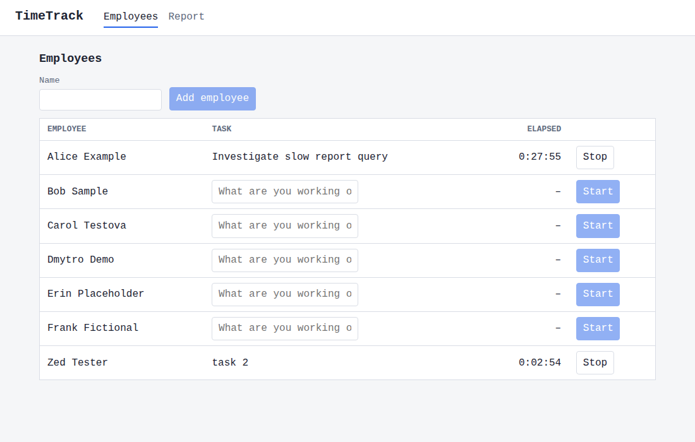

# TimeTrack

A small web app for tracking employees' working time. Add employees, start and stop a timer with a
task description, and see the records and total time per employee for a selected period. Data lives
in PostgreSQL and survives restarts. There is no authentication and all data is fictional.

ASP.NET Core (.NET 10) Minimal API + EF Core/Npgsql, PostgreSQL 17, Angular, Docker Compose.

## Quick start

Needs only Docker.

    git clone https://github.com/victor-v-shevchenko/TimeTrack.git && cd TimeTrack
    cp .env.example .env          # PowerShell: Copy-Item .env.example .env
    # edit POSTGRES_PASSWORD in .env
    docker compose up --build
    # optional: load demo data (see seed/README.md)

Open http://localhost:8080.

`docker compose down` keeps the data, `docker compose down -v` wipes it.

## Development

Prerequisites: Docker and VS Code with the Dev Containers extension.

1. Copy `.devcontainer/.env.example` to `.devcontainer/.env` and edit `POSTGRES_PASSWORD`.
2. "Dev Containers: Reopen in Container". The first start restores packages and installs browsers
   for the Playwright MCP server, so it takes a few minutes.
3. Dev loop, inside the container (`/workspace`):

       dotnet watch --project backend/TimeTrack.Api     # API on :5000, Swagger UI at http://localhost:5000/swagger
       cd frontend && npm start                         # ng serve on :4200, proxies /api to :5000

4. Tests:

       dotnet test backend       # needs the db service of the dev container
       cd frontend && npm test   # Vitest

The dev database (`pgdata-dev`) is separate from the Compose stack (`pgdata`). Swagger UI is only
enabled in Development, so it is not available at :8080.

## Configuration and secrets

Nothing secret is committed. Details in [PLAN.md §6](PLAN.md).

- Credentials come from environment variables: `.env` for the Compose stack and
  `.devcontainer/.env` for the dev container. Both are gitignored; the `.env.example` files hold
  placeholders. A missing `.env` makes Compose fail immediately with a hint.
- The connection string is built in `.env` from the same variables and passed to Compose as a
  secret. It is mounted at `/run/secrets/ConnectionStrings__Default` and read with
  `AddKeyPerFile("/run/secrets", optional: true)`, so it is not visible in `docker inspect` or the
  container environment. Postgres reads its password from `/run/secrets/db_password`.
- Local Compose secrets are plain bind-mounted files, not encrypted. They keep credentials out of
  the repo, the images and the environment. A real deployment would use a secret store behind the
  same configuration key.
- The password is applied only when Postgres initializes its volume. After changing it, run
  `docker compose down -v`.
- To run the API outside Docker, set `ConnectionStrings__Default` as an environment variable.
  The API fails at startup if the connection string is missing, and never logs it.

## Design notes

- **One running timer per employee.** A service check and the partial unique index
  `ux_time_entries_one_running`; a unique violation (23505) is mapped to 409, so two concurrent
  starts cannot both succeed.
- **UTC everywhere.** Times are `DateTimeOffset` in UTC (`timestamptz`). Only the UI converts to
  local time (`frontend/src/app/core/time.ts`).
- **Report periods are half-open `[from, to)`.** An entry is included if it overlaps the period and
  its duration is clipped to it. A running entry is counted up to now. The UI sends `to` as the day
  after the selected end date at local midnight.
- **Migrations are applied on startup** (`Database.Migrate()`).
- **`TimeProvider` is injected** instead of reading the wall clock, so time is controllable in tests
  (`FakeTimeProvider`).
- Errors are RFC 7807 `ProblemDetails`, produced by one `IExceptionHandler`.

## API

| Method | Path | Behavior |
|--------|------|----------|
| POST | `/api/employees` | Create; 422 empty name, 409 duplicate |
| GET  | `/api/employees` | List with the active entry (or `null`) |
| POST | `/api/employees/{id}/timer/start` `{description}` | 201; 409 already running; 404 unknown employee |
| POST | `/api/employees/{id}/timer/stop` | 200 with the closed entry; 409 nothing running |
| GET  | `/api/reports?from=&to=&employeeId=` | Entries and total seconds per employee; 422 if `from >= to` |

Report for the last 7 days (bash):

    curl "http://localhost:8080/api/reports?from=$(date -u -d '7 days ago' +%FT%TZ)&to=$(date -u +%FT%TZ)"

## Tests

Backend tests are xUnit against a real PostgreSQL, with no mocks of `DbContext`. `ApiFactory`
creates one database per test class from the same connection string the app uses, applies the
migrations and drops it afterwards. Time is a `FakeTimeProvider`.

| Required scenario | Test |
|-------------------|------|
| Restart the timer | `TimerTests.Restart_creates_second_entry_and_leaves_the_first_unchanged` |
| Empty report | `ReportTests.Empty_report_lists_every_employee_with_zero`, `Empty_report_filtered_by_employee_without_entries_has_one_zero_total` |
| Data persistence | `PersistenceTests.Data_survives_restart` (includes a running timer) |

Also covered: validation and duplicate names, double start (including a parallel race), stop with
nothing running, period clipping, running entries, `from >= to`, fail-fast on a missing connection
string. Frontend tests (Vitest) cover `ApiService`, the UTC date conversion, error messages, the
report empty state and the start/stop row.

## AI tools

- **Claude Code with Claude Opus 5.5** wrote most of the implementation, working from
  [PLAN.md](PLAN.md), the per-step specs in [docs/specs/](docs/specs/) and [CLAUDE.md](CLAUDE.md),
  one step per commit.
- **Claude Sonnet 5.5 via `/code-review`** reviewed the code in step 8. Some sessions
  (for example the seed script in step 7) ran on Sonnet 5.5; `docs/ai-log.md` names the model per entry
  where it was recorded.

A different model reviews so that it does not share the blind spots of the model that wrote the
code. The review found real bugs that the author's own tests had missed (see below).

## Example prompts

Verbatim from the session history. The prompt that produced PLAN.md was in an earlier session that
is not in the saved history, so it is not included.

1. Implement a step: `continue with @docs/specs/03-services.md`
2. Review step: `start with @docs/specs/08-ai-review.md`
3. Check the work against the spec: `Validate  Acceptance criteria for step 7`
4. Follow up on checks the agent had skipped: `validate skipped checks`
5. Keep the docs in sync: `update the Claude.md according to the changes and amend it to the commit`

## Errors found and fixed

| Bug | Found by | Fix |
|-----|----------|-----|
| Exception handler returned a bodyless 500 when `Accept` excluded JSON | `/code-review`, then a failing test | Write `application/problem+json` directly |
| Timer start validated the description before checking the employee (422 instead of 404) | `/code-review`, then a failing test | Existence check first |
| Employee row subscription without `takeUntilDestroyed` | `/code-review`, then a failing test | `takeUntilDestroyed(this.destroyRef)` |
| UTC conversion outside `time.ts`, stale list handling | `/code-review` | `toUtcIso` in `time.ts`, reload after add, latest-wins load |
| Running entries were listed for future periods (next week showed 2 rows with 0 s, not the empty state) | manual clean-clone check | A running entry ends at now for the overlap test |
| Seed script numbered weekdays before `LIMIT`, so one entry was never inserted | manual check | Number the days in an outer query |
| Wrong step 2 spec/tooling assumptions (KeyPerFile package, `global.json`) | build and test failures | Spec corrected |
| Dev container created `frontend/` and `node_modules` root-owned | `npm install` failure | `chown` in `postCreateCommand` |

Full log: [docs/ai-log.md](docs/ai-log.md). Seed data: [seed/README.md](seed/README.md).

## Possible improvements

Editing and deleting entries, CSV export, authentication, pagination, per-user timezone settings,
an external secret store, splitting the dev container per frontend/backend, a CI pipeline.
